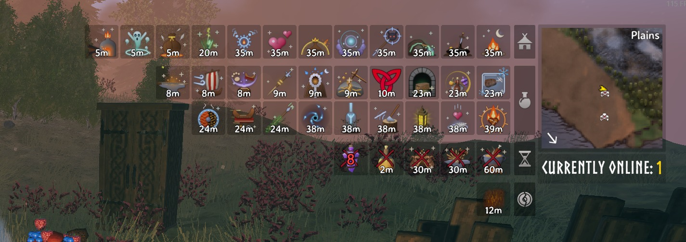
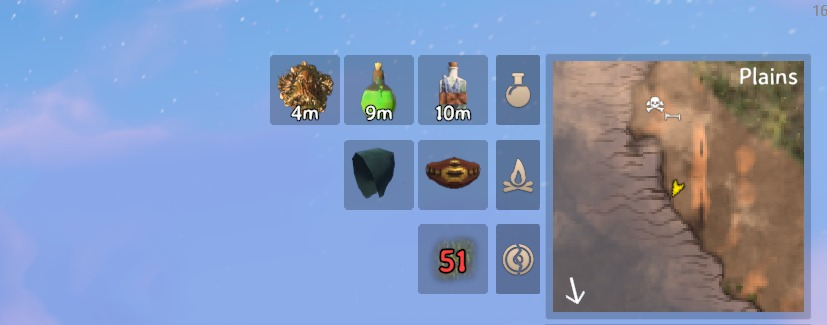
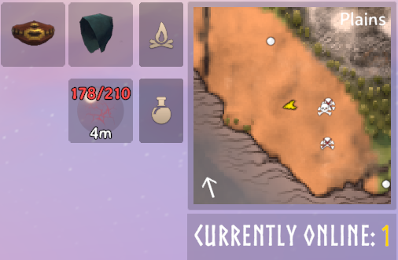

# StatusGroups

## A tidy status bar, however many buffs you stack!

Three meads, rested, shelter, a guardian power, set bonuses, a few rites... and the top right of your screen turns into a wall of big icons and names.

**StatusGroups shrinks the icons and sorts them into groups: buffs, cooldowns, negatives and passive effects.** Pick the layout you like: small icons in a row per group, or one icon per group.

---

### 📸 Screenshots

**40 statuses at once, still easy to read.** Buffs, cooldowns and [TempestRite](https://thunderstore.io/c/valheim/p/JoksterCube/TempestRite/)'s rites each get their own rows, marked by the icon on the right.

<p align="center">
	
</p>

**A normal day in the Plains:** a few meads and your worn gear, one small row each.

<p align="center">
	
</p>

**Magic Barrier shows how much it can still take:** damage left and its full strength, in red on top of the icon.

<p align="center">
	
</p>

---

### 🧭 Features

- **🔹 Three layouts:** **Icons** (small icons, a row per group), **Stacked** (one icon per group, with how many it holds and the time of the one ending first) or **Vanilla** (the game's own list).
- **🗂️ Four groups:** Buffs, Cooldowns, Negatives and Passive, for the game's statuses and any mod's.
- **🏷️ Group icons:** a mead bottle, an hourglass, a cracked shield and a campfire mark each group's row. Or pick any status's icon for it.
- **🎛️ Per group:** show each group expanded, stacked or hidden, rename it and put the groups in any order. Longer groups go on top, and a group too long for one row is split evenly (6 and 5, not 10 and 1).
- **📏 Your size and text:** icon size, statuses per row, names on or off, and the color and size of every text. Times show whole minutes, and grow big and red in the last minute.
- **🛡️ Barrier strength:** Magic Barrier shows the damage it can still absorb, like `178/210`, on top of its icon.
- **🖱️ Put it anywhere:** press **Esc** and drag the icons where you want them. Right-click to put them back. Stacked groups open up while the menu is open, so you can see what they hold.
- **✍️ Your own rules:** move any status, from the game or any mod, into any group, or make new groups.
- **🌩️ Other JoksterCube mods:** TempestRite's blessings join Buffs and kinship waits Cooldowns, and its Domain & Reckoning rites and World Rites get a group each. PingMark's Perception goes to Buffs, ProtectSpawnerFarms' statuses to Passive.

---

### 🗂️ Groups

| Group | What goes there |
| --- | --- |
| Buffs | Rested, the forsaken power, meads and anything else drunk or eaten that isn't food, and other effects that run out (Corpse run, No skill drain...). |
| Cooldowns | Waits shown with a crossed-out icon, like the healing and stamina meads' wait. |
| Negatives | Wet, Cold, Freezing, Burning, Frost, Shock, Poison, Smoked, Encumbered, Tarred and the like. |
| Passive | Resting, Shelter, Campfire, Cozy, Warm, worn gear and set bonuses (Demister, Wishbone...), and other effects that last while something holds. |

With [TempestRite](https://thunderstore.io/c/valheim/p/JoksterCube/TempestRite/):

| Group | What goes there |
| --- | --- |
| Domain & Reckoning | The rites worked at an obliterator, and the fights and rites that end others. |
| World Rites | Atmospheric, Celestial and Biome Mastery rites. |
| Buffs / Cooldowns | Blessings join Buffs, kinship waits join Cooldowns. |

**Custom Rules** come first. A comma separated list of `status=group`, where the status is its name in game or its internal name, and `*` matches anything:

```
Wishbone=Buffs, SE_MyMod_*=My Mod, Shelter=At Home
```

A group named in a rule appears in the **Groups** settings, so you can stack, hide or move it like any other. Turn on **Log Statuses** (an advanced setting) to see every status's internal name and group in the BepInEx log.

---

## ⚙️ Installation

Install with a mod manager (r2modman, Thunderstore App), or manually:

1. Install **BepInExPack Valheim**.
2. Extract StatusGroups into `BepInEx/plugins`.
3. Launch the game. Settings are in `BepInEx/config/JoksterCube.StatusGroups.cfg`, or in game with Configuration Manager (F1). Changes show at once.

---

### 🧩 Multiplayer & Compatibility

- ✅ **Client only.** It only changes what your own HUD shows, so it works in single-player and on any server, with or without the mod.
- 🌩️ **Made to go with [TempestRite](https://thunderstore.io/c/valheim/p/JoksterCube/TempestRite/):** its many blessings, rites and waits are sorted into groups of their own, named in your language.
- ✅ Other players don't need it, and nobody needs the same version.
- ⚠️ Other mods that also redraw the status list may clash with it. Pick **Vanilla** to hand the list back to the game.

---

### 🔧 Configuration

The settings most people change:

| Setting | Default | What it does |
| --- | --- | --- |
| Layout | Icons | `Icons`, `Stacked` or `Vanilla`. |
| Split By Group | On | A block for each group. Off: every status in one block. |
| Icon Size | 0.75 | Icon size compared to the game's (0.3–1.5). |
| Statuses Per Line | 18 | Statuses in a row before the next row starts. |
| Show Names | Off | Each status's name, under its time. |
| Show Group Names | Off | The group's name above its block. |
| Show Group Icons | On | The group's icon beside its block. |
| Status Boxes | On | Each status in a small square, its time on the icon. Off: times under the icons. |
| Text Color | White | Color of every text. Times under a minute show in red. |
| *Group* Display / Name / Icon / Order | | Each group: `Default`, `Expanded`, `Stacked` or `Hidden`, your own name, the status whose icon marks it, and its place. |
| Custom Rules | empty | Your own `status=group` rules. |

Font sizes, name width, seconds, sorting and more are in the config file and Configuration Manager, each setting explained there.

---

### 🛠️ For mod authors

Give your mod's statuses their own groups, with no reference to StatusGroups: call `JoksterCube.StatusGroups.StatusGroupsApi` by reflection, so your mod still works without it.

```csharp
[BepInDependency("JoksterCube.StatusGroups", BepInDependency.DependencyFlags.SoftDependency)]

// In Awake:
if (Chainloader.PluginInfos.TryGetValue("JoksterCube.StatusGroups", out PluginInfo info) && info.Instance)
{
    Type api = info.Instance.GetType().Assembly.GetType("JoksterCube.StatusGroups.StatusGroupsApi");
    api.GetMethod("AddGroup", [typeof(string), typeof(Func<string>), typeof(int)])
        .Invoke(null, ["MyMod Buffs", (Func<string>)(() => "Buffs"), 2000]);
    api.GetMethod("Assign", [typeof(string), typeof(string)]).Invoke(null, ["SE_MyMod_Haste", "MyMod Buffs"]);
    // Or every status starting with a prefix:
    api.GetMethod("AssignPrefix", [typeof(string), typeof(string)]).Invoke(null, ["SE_MyMod_", "MyMod Buffs"]);
    // Optional: the group's icon (pale: a pale silhouette, tinted like the built-in groups' icons).
    api.GetMethod("SetGroupIcon", [typeof(string), typeof(Func<Sprite>), typeof(bool)])
        .Invoke(null, ["MyMod Buffs", (Func<Sprite>)(() => myIcon), false]);
}
```

- **id** (`"MyMod Buffs"`): also the name of the group's settings and what players write in Custom Rules. Start it with your mod's name.
- **name**: shown above the group's row and on its stacked icon. Asked for each time, so it can follow the game's language (a `$token` works too).
- **order**: the group's place, lower first. Pick a free one:

| Order | Mod | Group |
| --- | --- | --- |
| 100–1000 | StatusGroups | Buffs (100), Passive (400), Cooldowns (800), Negatives (1000) |
| 200, 500 | TempestRite | Domain & Reckoning, World Rites (set by StatusGroups, whatever TempestRite asks) |
| 5000 | StatusGroups | Groups named only in Custom Rules |

A mod can also put its statuses into the four built-in groups by their ids: `Buffs`, `Cooldowns`, `Negatives`, `Passive`.

---

### 💬 Feedback & Support

Report bugs or suggest improvements on [GitHub](https://github.com/JoksterCube/StatusGroups/issues).

---

**Author:** JoksterCube<br>
**Version:** 1.0.4<br>
**License:** GNU GPL v3 or later
